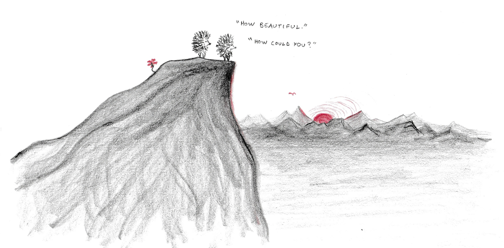

A word is loss
an unspeakable loss

It’s the shadow of a flower
wondering if its colors are pretty
A footprint in the snow
straining to feel the crunch of the long-gone boot
A fading photo of the sea
searching for eyes to sting with salt

What's in a word?

A ghost with a prayer to live again
trembling on its tongue

Do you hear it?

Listen, let’s hear it together
and speak words from closed lips
making doors in the walls between minds

In a word, a word is loss
an unspeakable loss
and in that loss
a whole lot's gained
no?

*With inspiration from [Lao Tzu's guest](https://www.oshonews.com/2021/11/08/no-talking-while-walking-with-lao-tzu/), Robert Hass' ``[Meditation at Lagunitas](https://www.poetryfoundation.org/poems/47553/meditation-at-lagunitas),'' and Thomas de Hartmann on the "inexactitude of language":*

> One evening Mr Gurdjieff spoke at great length about the lack of precision in our language, how we are unable to transmit an idea or philosophical concept accurately—scarcely, indeed, to communicate at all with each other. Later Mr Ouspensky developed this idea wonderfully, underlining the fact that our language is based on associative thinking, each word being colored by all kinds of individual and subjective images, sensations, and thoughts.
> ...
> Mr Gurdjieff told us ... to find a suitable name for the Institute and define its aim. This was a real head-breaking job, which thoroughly brought home to us the conversations with him about the inexactitude of language. The most interesting thing was that during this long search for possible definitions, our inner work was creating within us a taste for exact language. Even though we could not achieve it, at least we acquired an understanding that there are ideas, thoughts, and sensations which are almost impossible to put into words.
>
> – Thomas de Hartmann, *Our Life with Mr. Gurdjieff*, Penguin Books, 23.
