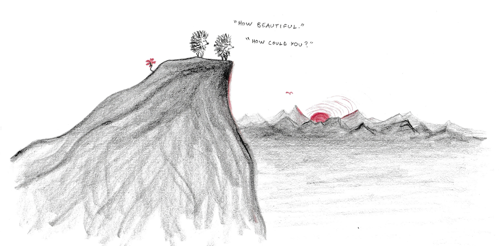

A word is loss
an unspeakable loss

It’s the shadow of a flower
wondering if its colors are pretty
A footprint in the snow
straining to feel the crunch of the long-gone boot
A fading photo of the sea
searching for eyes to sting with salt

What's in a word?

A ghost with a prayer to live again
trembling on its tongue

Do you hear it?

Listen, let’s hear it together
and speak the words of closed lips
carving doorways in the walls between two minds

In a word, a word is loss
an unspeakable loss
and in that loss
a whole lot's gained
don't you think?

*With inspiration from [Lao Tzu's guest](https://www.oshonews.com/2021/11/08/no-talking-while-walking-with-lao-tzu/) and Robert Hass' ``[Meditation at Lagunitas](https://www.poetryfoundation.org/poems/47553/meditation-at-lagunitas).''*